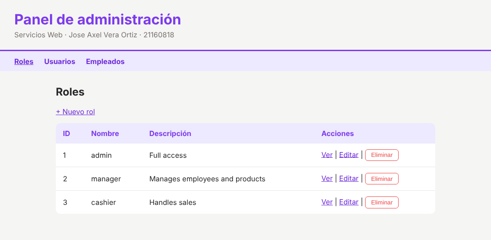
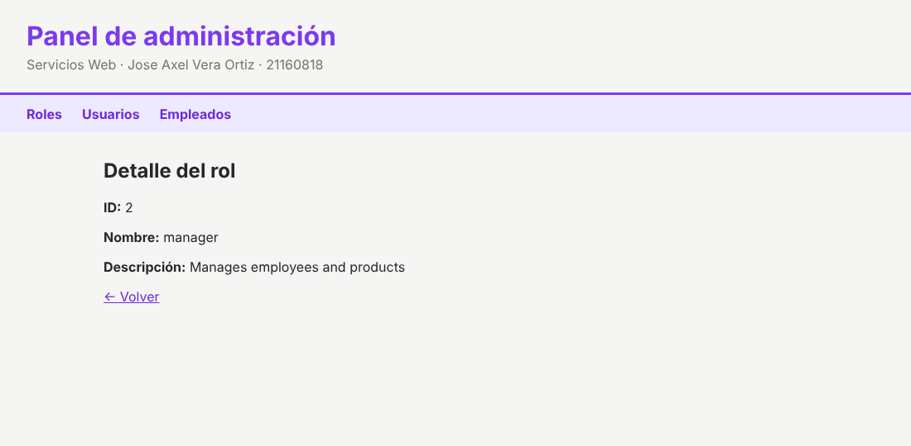
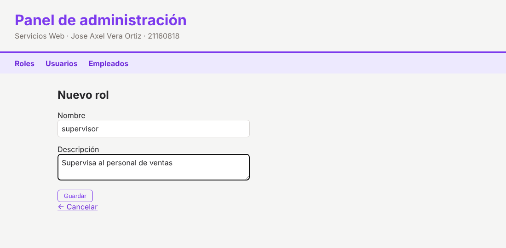
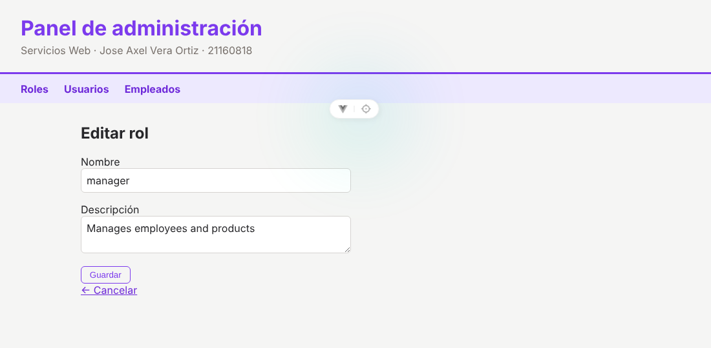
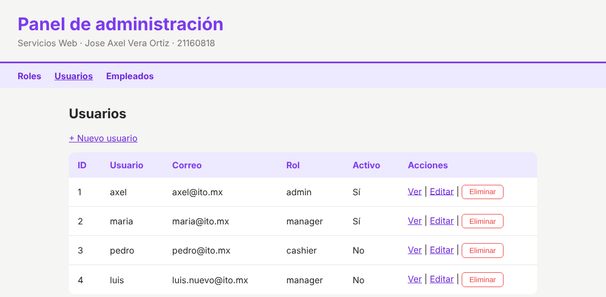
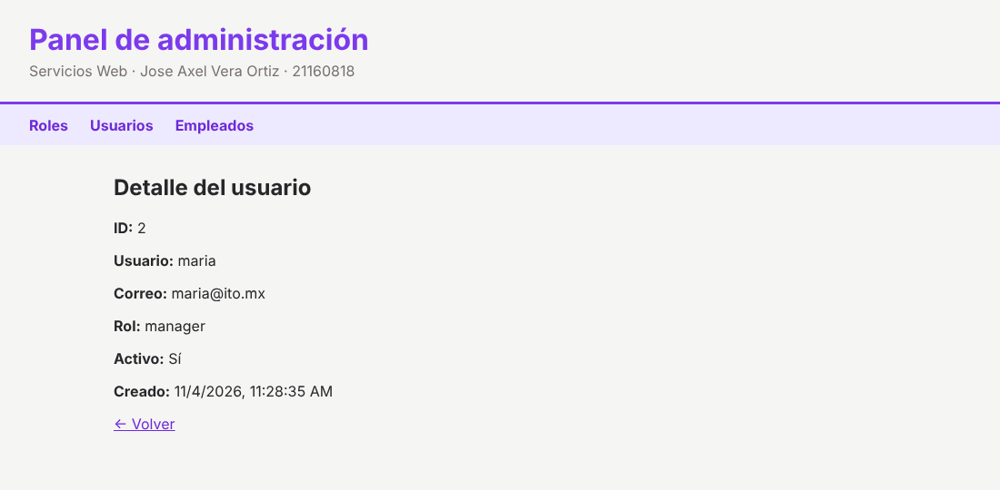
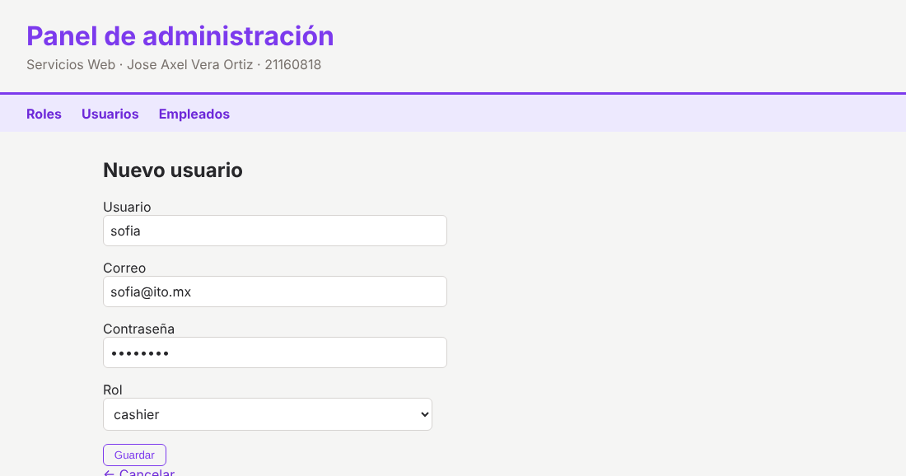
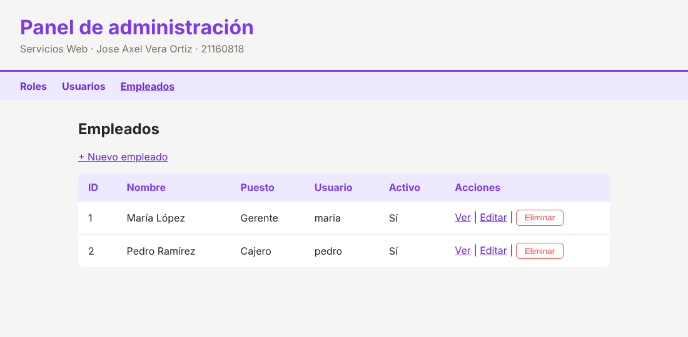
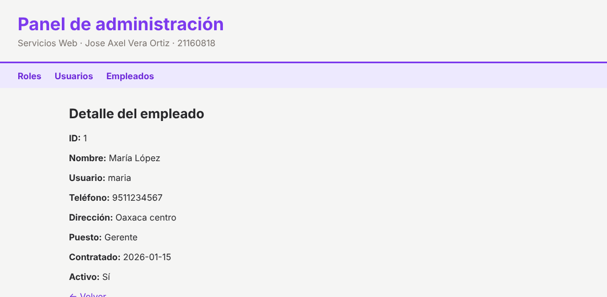
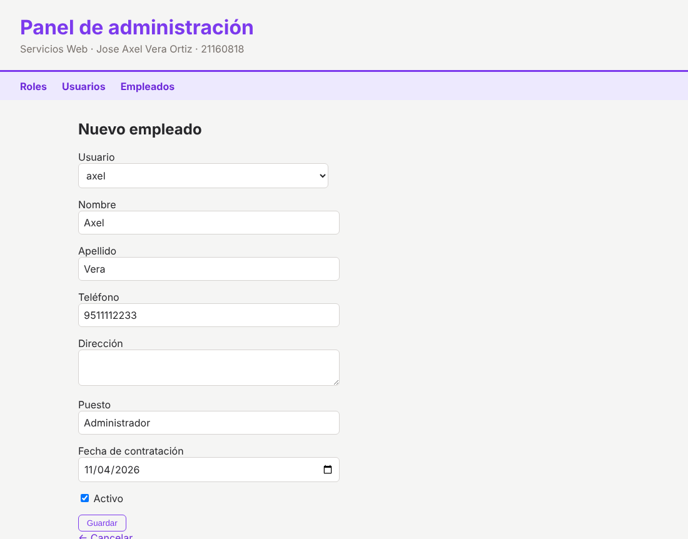

# Panel de administración

Frontend hecho con **Vue 3 + TypeScript** que consume el microservicio de [backend_for_students](https://github.com/BanderoChinoZF/backend_for_students/tree/BFS-0002) (rama `BFS-0002`). Tiene el **CRUD completo de roles, usuarios y empleados**: ver todos, ver uno, crear, editar y eliminar.

**Alumno:** Jose Axel Vera Ortiz · 21160818

**Materia:** Servicios Web · Instituto Tecnológico de Oaxaca

## Capturas

### Roles

| Lista de roles | Detalle de un rol |
| :---: | :---: |
|  |  |

| Crear rol | Editar rol |
| :---: | :---: |
|  |  |

### Usuarios

| Lista de usuarios | Detalle de un usuario | Crear usuario |
| :---: | :---: | :---: |
|  |  |  |

### Empleados

| Lista de empleados | Detalle de un empleado | Crear empleado |
| :---: | :---: | :---: |
|  |  |  |

## Qué hace

Arriba hay un menú para cambiar entre **Roles**, **Usuarios** y **Empleados**. Cada sección tiene las mismas 4 vistas:

| Vista | Roles | Usuarios | Empleados |
| --- | --- | --- | --- |
| Ver todos | `/roles` | `/usuarios` | `/empleados` |
| Ver uno | `/roles/:id` | `/usuarios/:id` | `/empleados/:id` |
| Crear | `/roles/nuevo` | `/usuarios/nuevo` | `/empleados/nuevo` |
| Editar | `/roles/:id/editar` | `/usuarios/:id/editar` | `/empleados/:id/editar` |
| Eliminar | botón en la tabla | botón en la tabla | botón en la tabla |

Endpoints del backend que consume:

| Recurso | Endpoint | Métodos |
| --- | --- | --- |
| Roles | `/api/v2/roles` | `GET`, `GET /:id`, `POST`, `PUT /:id`, `DELETE /:id` |
| Usuarios | `/api/v2/usuarios` | `GET`, `GET /:id`, `POST`, `PUT /:id`, `DELETE /:id` |
| Empleados | `/api/v2/employees` | `GET`, `GET /:id`, `POST`, `PUT /:id`, `DELETE /:id` |

- Las peticiones se hacen con **axios**, un archivo de service por recurso.
- Crear y editar usan el **mismo formulario**: si la ruta trae `id`, carga los datos y los actualiza; si no, crea uno nuevo.
- **Usuarios:** el rol se elige de un select con los roles que existen. Al editar, la contraseña solo se cambia si se escribe una nueva.
- **Empleados:** el usuario se elige de un select con los usuarios que existen. Teléfono, dirección y puesto son opcionales.
- Antes de eliminar pide confirmación. Si el backend responde con error (nombre repetido, contraseña muy corta, usuario con empleado asociado, etc.), se muestra su mensaje en pantalla.

## Estructura

```
src/
├── App.vue                          # Encabezado, menú, <RouterView> y estilos generales
├── main.ts                          # Arranca la app con el router
├── router/index.ts                  # Rutas de las vistas
├── services/
│   ├── roles.service.ts             # Llamadas a /api/v2/roles
│   ├── usuarios.service.ts          # Llamadas a /api/v2/usuarios
│   ├── empleados.service.ts         # Llamadas a /api/v2/employees
│   └── error.ts                     # Saca el mensaje de error del backend
└── views/
    ├── RolesView.vue                # Tabla de roles
    ├── RolDetalleView.vue           # Información de un rol
    ├── RolFormView.vue              # Crear y editar rol
    ├── UsuariosView.vue             # Tabla de usuarios
    ├── UsuarioDetalleView.vue       # Información de un usuario
    ├── UsuarioFormView.vue          # Crear y editar usuario
    ├── EmpleadosView.vue            # Tabla de empleados
    ├── EmpleadoDetalleView.vue      # Información de un empleado
    └── EmpleadoFormView.vue         # Crear y editar empleado
```

## Cómo correrlo

Requiere Node.js 22.18 o más reciente.

1. Levantar el backend ([backend_for_students](https://github.com/BanderoChinoZF/backend_for_students/tree/BFS-0002), rama `BFS-0002`) con su conexión a la base de datos. Debe quedar en `http://localhost:3000`:

```sh
npm run dev
```

2. En este proyecto:

```sh
npm install
npm run dev
```

3. Abrir http://localhost:5173

La dirección del backend está en cada archivo de `src/services/` (`const API`). Si el backend corre en otro puerto, se cambia ahí.

Para probar todo en orden: primero crear un **rol**, luego un **usuario** con ese rol y al final un **empleado** con ese usuario.
